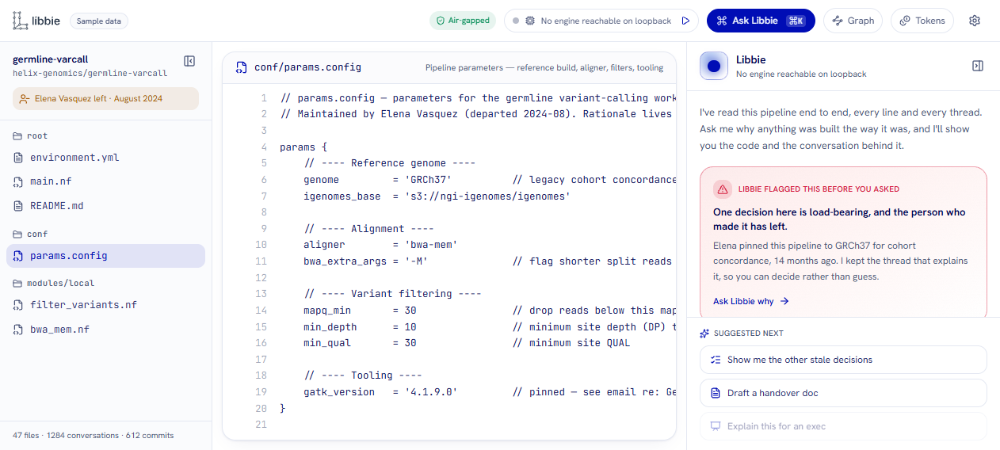
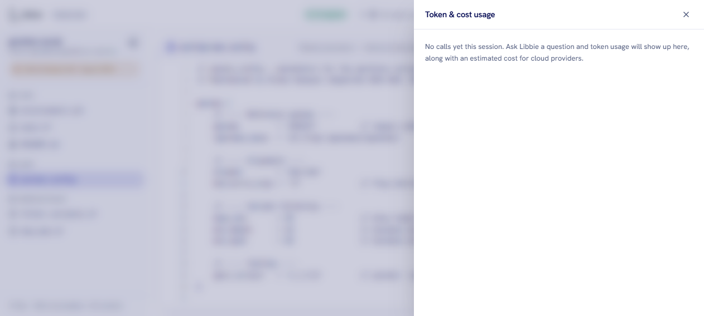
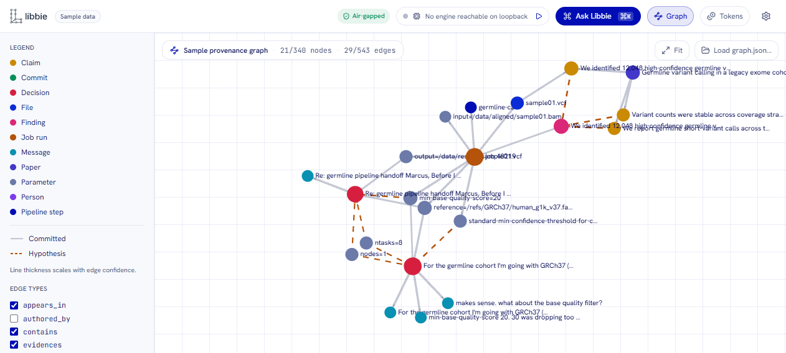
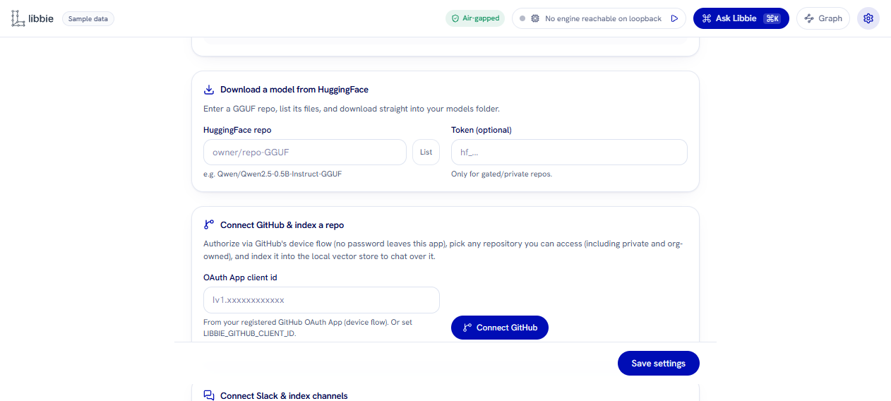
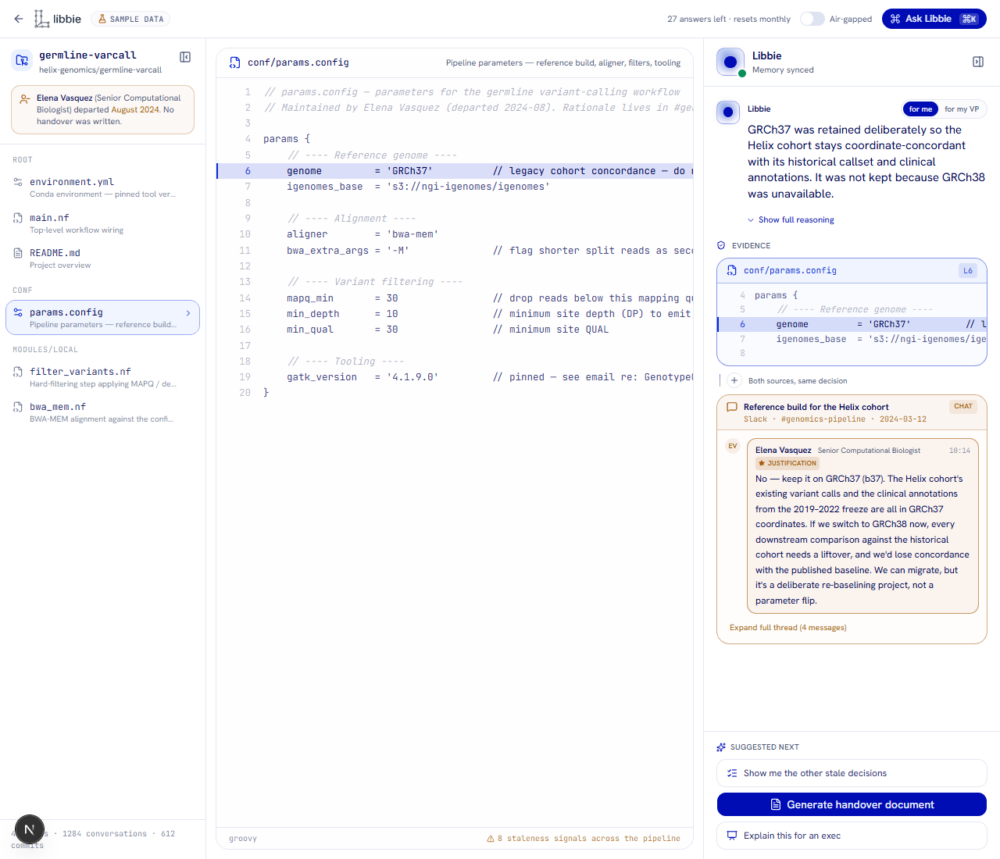

# Testing Libbie by hand

This is the walkthrough I'd follow to convince myself Libbie actually works, written for a
person sitting at the keyboard rather than for CI. You don't need a GPU or any API keys to see
the interesting parts. The fastest convincing test is the engine on its sample data (about five
minutes), so if you only do one thing, do that.

Three things you can test, roughly in order of effort:

1. The **engine** (Python) on bundled sample data. No keys, no GPU, no network.
2. The **desktop app** (Tauri). Needs a local model or a cloud key to actually chat.
3. The **web demo** (Next.js). Sample data, runs in a browser.

## What you'll need

- Python 3.10+ for the engine, Node 20+ for the web and desktop UIs, and Rust 1.77+ if you want
  to build the desktop app from source.
- Optional, only for chatting in the desktop app: a `llama-server` binary plus a GGUF model, or
  an API key for a cloud provider.
- Optional, only for the live connectors: your own GitHub / Slack / Gmail account (and, for the
  OAuth flows, a registered app id, see the note at the end).

Paths below assume Windows (the venv lives in `.venv\Scripts\`). On macOS or Linux use
`.venv/bin/` instead.

## The 60-second check: run the tests

This proves the code compiles and the logic holds, without setting anything up.

```bash
# Engine
cd engine
python -m venv .venv && ./.venv/Scripts/pip install -e ".[dev,connectors]"
./.venv/Scripts/python -m pytest -q            # expect 60 passing, under a second

# Desktop (Rust core)
cd ../desktop/src-tauri
cargo test --lib                               # expect 50 passing
cargo fmt --check && cargo clippy --all-targets -- -D warnings

# Web + desktop webview build
cd ../../libbie && npm install && npm run build
cd ../desktop && npm install && npm run build
```

If those pass you already know the build is healthy. The rest is about seeing it behave.

## The one-command engine check

If you only run one thing, run the smoke test. It drives the whole offline pipeline (ingest, join,
eval, briefing) over the bundled sample data and prints a PASS/FAIL line, so you get a yes/no in a
few seconds without reading any output yourself.

```bash
cd engine
python -m venv .venv && ./.venv/Scripts/pip install -e ".[dev,connectors]"
./.venv/Scripts/python scripts/smoke_test.py     # macOS/Linux: ./.venv/bin/python
```

You should see twelve green checks and `SMOKE TEST PASSED`. It exits 0 on success and 1 if anything
is off, so it also works as a health check in a script. The section below does the same run by hand
if you want to actually read the briefing.

## Test the engine on the sample data

This is the best five minutes you can spend. It ingests a small made-up genomics lab, joins the
pieces into a graph, and writes a briefing. It runs fully offline (the default LLM backend is a
deterministic mock), so nothing leaves your machine.

```bash
cd engine
./.venv/Scripts/libbie ingest --all --sample     # parse HPC + git + Slack/.eml + a paper
./.venv/Scripts/libbie join                      # build the edges
./.venv/Scripts/libbie brief --pipeline germline # the handover doc
./.venv/Scripts/libbie eval                      # scores the graph against the gold set
```

What to look for in the briefing: a section called "Decisions nobody wrote down" that ties the
`reference = GRCh37` parameter to the Slack thread where Elena argued for it, and a "What it
produced" section linking the run's output file to the paper's claim. That chain, from a config
line to the conversation that justified it, is the whole point of the product. `eval` prints
precision and recall per edge type. On the bundled sample it should be perfect, and it should
still refuse to commit the one deliberately-wrong edge (a "30" that shows up in the thread but
refers to something else). Seeing it hold that line is more reassuring than the perfect score.

There's a larger, messier test scenario too, with four pipelines and 143 hand-labelled edges:

```bash
./.venv/Scripts/python -m eval_scenario.run_eval   # expect around P 0.97 / R 0.95
```

The misses there are honest ones. The offline mock can't judge meaning, so the two
meaning-dependent edge types slip. Pointing the engine at a real LLM (`llm.backend: api` in
`config.yaml` with an `ANTHROPIC_API_KEY`) is what closes that gap, and it's the next thing worth
measuring.

## Point the engine at your own repo, Slack, or email

Optional, and it needs your own accounts. Everything read-only.

```bash
# A GitHub repo you can access (public, private, or org)
export LIBBIE_GITHUB_CLIENT_ID=<your OAuth app id>
./.venv/Scripts/libbie github login        # opens a URL, you type the code
./.venv/Scripts/libbie github ingest yourorg/yourrepo

# Slack: paste a user token (xoxp-...) from your own Slack app
./.venv/Scripts/libbie slack token
./.venv/Scripts/libbie slack channels
./.venv/Scripts/libbie slack ingest C0123 C0456

# Email over IMAP (works with any provider + an app password)
./.venv/Scripts/libbie email imap --host imap.fastmail.com --user you@example.com

# then, as before:
./.venv/Scripts/libbie join && ./.venv/Scripts/libbie brief --pipeline <name>
```

## Test the desktop app

If you have Rust set up, run it as a real app:

```bash
cd desktop && npm install && npm run app:dev
```

If you'd rather not build Tauri, you can open just the webview in a browser with `npm run dev`
(http://localhost:1420). Most of the UI renders there, but the connectors, model download, and
"load a graph file" button only work inside the real app, so they'll say "desktop app only" in
browser mode. The knowledge graph still renders its bundled sample, which is handy for a quick
look.



Once it's open, click the Settings gear and pick how you want to run it:

- **Local model.** Point it at a GGUF you already have, or use "Download a model from
  HuggingFace" to pull a small one (turn off strict air-gap first, downloads are blocked while
  it's on). Press Start engine, wait for the status pill to go green, then ask a question.
- **Cloud provider.** Turn off strict air-gap, choose OpenAI-compatible or Anthropic, paste your
  key and a model name. No local engine needed.

Then press Ask Libbie (Cmd/Ctrl+K) and ask something like "why GRCh37?". You should get a short
verdict followed by both a code citation and a conversation citation. That dual citation is the
thing to check.

While you're in there, three more things worth a look:

- **Tokens** (top bar). Ask a couple of questions and watch it count input and output tokens for
  the session. Local models show tokens per second; cloud models show an estimated dollar cost.

  
- **Graph** (top bar). This is the provenance graph as a force-directed diagram: nodes coloured
  by type, solid links for confirmed relationships and dashed amber ones for unverified guesses,
  thicker links for higher confidence. Click a node to inspect it, and use the filters on the
  left. It opens on a legible core; toggle `authored_by` back on if you want to see the full mesh.

  

- **Connectors.** Settings has Connect GitHub, Connect Slack, and Connect Email. Turn off air-gap
  first (they're egress, so strict mode disables them on purpose). Connect an account, pick what
  to index, and then chat over it.

  

One behaviour worth testing deliberately: flip Strict air-gapped mode back on and confirm the
cloud provider, the download button, and every connector go dark. That switch is the security
promise, so it's worth seeing it bite.

## Test the web demo

```bash
cd libbie && npm install && npm run dev     # http://localhost:3000
```

Open `/demo`. It plays a short "reading your codebase" intro, then drops you into the workspace.
Ask one of the suggested "why" questions and you'll see the same dual-cited answer, the technical
versus executive toggle, the staleness panel, and the one-click handover export. This one is
authored sample data start to finish, and the UI says so, so treat it as a polished tour rather
than a live system.



This is the shot that shows the whole point. One answer, backed by the exact code line and the
exact conversation, with both visible at once.

## When something looks off

- **"The engine isn't running yet" in the desktop app.** You haven't picked a model. Open
  Settings, choose a GGUF and press Start engine, or switch to a cloud provider.
- **A connector or the download button is greyed out or refuses.** Strict air-gapped mode is on.
  Turn it off in Settings. That's by design, not a bug.
- **Slack OAuth won't complete.** Slack only allows a fixed redirect port, so either register
  `http://localhost:3118/callback` on your Slack app or skip OAuth and paste an `xoxp-` token,
  which needs no registration.
- **The installer warns that it's from an unknown developer.** The v0.1.0 builds aren't
  code-signed yet. On Windows, click through SmartScreen. On macOS, right-click the app and choose
  Open. Signing is on the backlog in `docs/NEXT_STEPS.md`.
- **The graph looks almost empty.** That's the default view hiding the noisy `authored_by` edges
  and any unconnected nodes. Turn those filters off on the left to see everything.
- **Engine `join` seems to commit nothing interesting.** Remember the default backend is the
  offline mock, which is conservative by design. Set a real backend to see the meaning-based
  edges get committed.

For anything deeper (architecture, the build gates, what's real versus staged), start with
[`CLAUDE.md`](CLAUDE.md) and [`docs/NEXT_STEPS.md`](docs/NEXT_STEPS.md).
